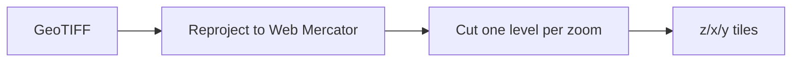

# Zoom levels and tiles

A web map does not load your whole image. It loads small square tiles, 256 × 256 pixels each,
for the part of the world on screen at the current zoom level. tilecut makes those tiles.

## How it works

At zoom 0 the whole world fits in one tile. Each zoom level doubles the width and height, so
zoom 1 has 4 tiles, zoom 2 has 16, and zoom *z* has 4^*z*. tilecut cuts only the tiles that
cover your image and stores them as `z/x/y.png`, the layout Leaflet and OpenLayers expect.

## Choosing a zoom range

- The highest useful zoom matches your pixel size. `tilecut info` suggests it: about zoom 14
  for 10 m pixels, zoom 17 for 1 m.
- Every extra level multiplies the tile count, and roughly the time, by four.

## Limits

- tilecut makes raster tiles only. It does not make vector tiles.

## Related

- [Tile a satellite scene for a web map](../examples/01-tile-a-satellite-scene.md)
- [Command line reference](../reference/cli.md)
