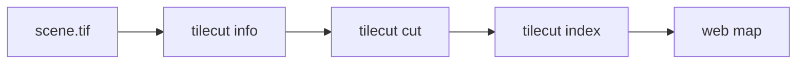

# Tile a satellite scene for a web map

In this example you publish a satellite scene on a web map. You start with a 1.2 GB GeoTIFF
and end with WebP tiles at zoom 10 to 14, served from your own computer.

Tested with tilecut 1.4.0 on Ubuntu 24.04, 2026-11-10.

## What you need

- tilecut installed; see [Installation](../installation.md).
- The sample data in [`examples/data/`](https://github.com/example-org/tilecut/tree/main/examples/data).
- Python 3 for the local web server in step 4.

## The workflow at a glance



## 1. Inspect the scene

Check the projection and the zoom range tilecut suggests before you cut.

```sh
tilecut info examples/data/scene.tif
```

```text
File:        scene.tif
Size:        18000 x 16000 px, 3 bands, uint8
CRS:         EPSG:32647
Resolution:  10.0 m
Zoom range:  8-14 (suggested)
```

## 2. Cut the tiles

Zoom 14 matches the 10 m resolution; higher zoom levels only make blurry tiles. WebP files are
about a third of the size of PNG.

```sh
tilecut cut examples/data/scene.tif --zoom 10-14 --format webp --out site/tiles
```

```text
Cutting scene.tif -> site/tiles/ (zoom 10-14)
[####################] 1365/1365 tiles
Done in 42.3 s
```

The same step from Python:

```python
import tilecut

result = tilecut.cut("examples/data/scene.tif", "site/tiles", zoom=(10, 14), fmt="webp")
print(result.tile_count)  # 1365
```

## 3. Write the map page

```sh
tilecut index site/tiles --title "Sample scene"
```

```text
Wrote site/tiles/index.html
```

## 4. Check the result

```sh
python -m http.server 8000 --directory site/tiles
```

```text
Serving HTTP on :: port 8000 (http://[::]:8000/) ...
```

Open <http://localhost:8000> and zoom from level 10 to 14. If tiles are missing, see
[Troubleshooting](../troubleshooting.md).

## 5. Clean up

Stop the server with Ctrl+C, then:

```sh
rm -r site
```

## What you did

- Checked a scene's projection and suggested zoom range.
- Cut it into WebP tiles and wrote a page that displays them.

## Next steps

- [Resume an interrupted run](../how-to/resume-an-interrupted-run.md)
- [Zoom levels and tiles](../concepts/zoom-levels-and-tiles.md)
